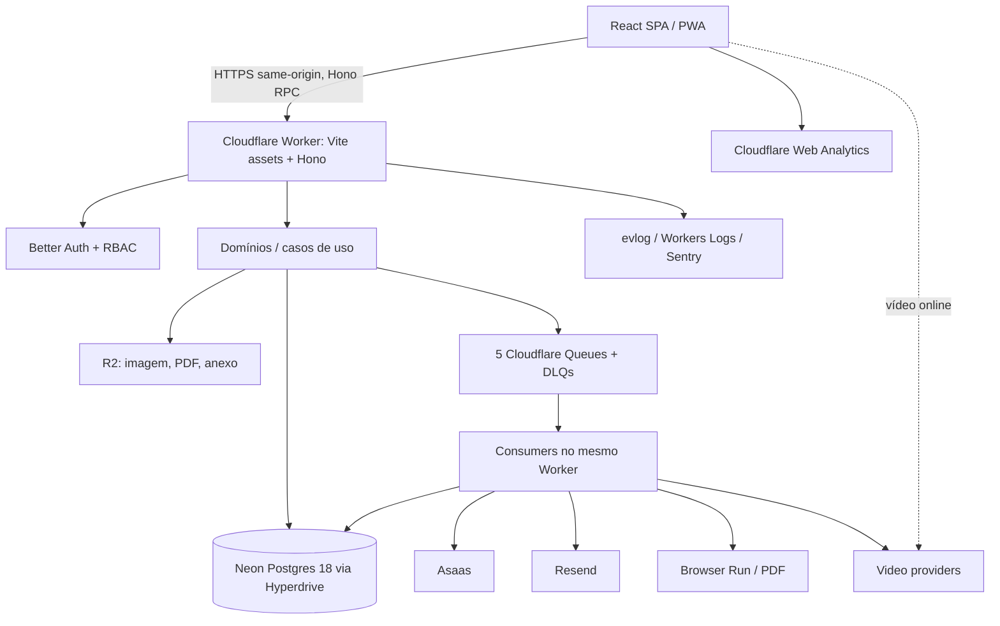

# 02 — Arquitetura consolidada do Hub vNext

## 1. Contexto e diretrizes

Produto LMS **NeuroCapacitar Hub**; PROTEA-R é Course, não o nome da plataforma. Público inicial: centenas de alunos, Staff pequeno; **single-tenant**, sem infraestrutura de escala artificial. Nova aplicação em repositório independente, sem obrigação de migrar base beta do legado Next.js/Vercel. O legado pode coexistir temporariamente para cumprir acessos/certificados históricos. Cloudflare-first pragmático, não exclusivo; fornecedores externos autorizados quando agregam valor.

**Escopo v1:** catálogo/Offers, cursos gratuitos e pagos, aprendizagem com vídeos/quizzes/discussões, currículo vivo, Auth, Staff/RBAC, Asaas, certificados, e-mails Resend, analytics, PWA com offline seletivo e operação/recuperação segura.

**Fora da v1 (decisões deferidas):** bundles multi-course, coupons, preview livre de curso pago, guest checkout, e-mail change, API pública externa, CMS/landing page, AI tutoring, real-time chat, Web Push, CSV export, tracking session replay/clickstream, materialização diária generalizada, coortes, assinaturas, DRM próprio, marketing CMS no Hub, helpdesk inbound, autoexclusão self-service, monorepo/microservices, SSR/Next/TanStack Start, DO/KV/D1/Worker Cache API, fallback ativo multicountry, editor tipo Figma de certificado, legenda própria de vídeo.

## 2. Diagrama lógico

Sem front/back deployáveis separadamente. Não colocar regras de negócio dentro de componentes React, handlers Hono ou implementações SDK. Entradas HTTP/Queue/Cron chamam casos de uso; domínio não importa Hono/React/Drizzle. Contratos públicos de cada feature impedem imports profundos. Sem repository pattern universal.

## 3. Stack aprovada

| Camada | Escolha |
|---|---|
| UI | React 19 (linha estável), SPA pura, Vite e Cloudflare Vite Plugin, React Compiler |
| Routing / dados | TanStack Router file-based + routeTree.gen.ts versionado; TanStack Query v5 |
| Form / validação | TanStack Form v1, Zod 4, servidor sempre revalida |
| API | Hono + Hono RPC type inference, JSON same-origin, sem SSR/RSC/Server Actions |
| Tabela / gráficos / rich text | TanStack Table v9, Virtual sob perfil, Recharts 3, Tiptap 3 restrito |
| UI visual | Tailwind CSS 4, shadcn Luma/Base UI, Phosphor, Lexend Deca, Geist Mono técnico, OKLCH, light/dark/system |
| Runtime / tools | Cloudflare Workers Paid, Bun 1.4.2 tooling, Node 24 LTS quando necessário, TS 7 strict, Oxlint+Oxfmt/Ultracite |
| Banco | Neon PostgreSQL 18 + Drizzle + `pg` via Hyperdrive direct endpoint, cache SQL desativado |
| Infra async | 5 Queues com DLQs, outbox/inbox Postgres, consumers no Worker e Cron reconciliation; Workflows só quando justificado |
| Armazenamento | R2 público/privado separado por ambiente, media master editado, transforms Images Free quando apropriado; nenhum Images Hosted |
| PDF | HTML/CSS confiável via Browser Run Quick Action `/pdf`, artefato R2 privado e hash |
| Identidade | Better Auth, sessões PG rolling 7d, Google + senha + passkeys opcionais, roles+grants |
| Comércio | Asaas Hosted Checkout, provider adapter, ordem/pagamento/evidência separadas |
| Comunicações | Resend Hosted Templates, transactional outbox + Contacts/Segments/Topics consentidos |
| Observabilidade | evlog wide events + Workers Logs/Tracing + Sentry + Web Analytics; audit logs PG separadamente |
| Testes | Vitest Node + @cloudflare/vitest-plugin + PostgreSQL 18 + Playwright Chromium/WebKit |
| Seg. repositório | GitHub Free privado pessoal; Semgrep CE, Gitleaks, Socket, Renovate, Dependabot Alerts, zizmor, actionlint, Knip, dependency-cruiser |

## 4. Design visual e experiência

StudentShell mobile-first, bottom nav curta em mobile e workspace de aula com player/conteúdo prioritários; StaffShell com sidebar desktop e drawer mobile, sem bottom navigation administrativa. Tokens semânticos em OKLCH ancorados nas cores institucionais (areia/bege, terracota, laranja, oliva e uso dosado de petróleo), Lexend Deca principal, Phosphor único sistema de ícones. Light/dark/system, system default; preferências tipadas. WCAG 2.2 AA como meta técnica (teste automatizado + revisão humana). UI não fornece permissões: botões desabilitados são apenas apresentação; backend decide.

## 5. Fluxos de negócio fundamentais

### 5.1 Aquisição gratuita

`User autenticado/conta verificada → Offer free adquirível → comando idempotente → Entitlement origem free_offer → Enrollment projeção → acesso`. **Sem Order, Payment, CheckoutSession e Asaas**. Revalidar suspensão, Offer, CourseRelease, acesso anterior/expiração e grants transacionalmente.

### 5.2 Aquisição paga

`User verificado → Offer paid → Order com snapshot → CheckoutSession Hosted Asaas (TTL 60m) → webhook autenticado → inbox PG → Queue → processor/reconciler → Payment autoritativo → Entitlement → Enrollment`. Reembolso integral por `RefundRequest` assíncrono; dispute suspende acesso, perda/refund final revoga, vitória restaura. Nunca executar chamada ao provider dentro de transação PostgreSQL.

### 5.3 Aprendizagem

`Enrollment válido → CourseRelease vigente → Module liberado pelo drip D+N → Lesson acessível conforme guided/free → LessonCompletion (evidência) → CourseCompletion histórico`. Apenas obrigatórias contam. Vídeo pode concluir no limiar Course default 90% sem anti-seek; autoavanço depende de evento `ended`, opt-in do aluno default off e contagem cancelável. Quiz como Lesson própria; discussões assíncronas por Lesson.

### 5.4 Certificados

Primeira `CourseCompletion` elegível cria intenção de emissão. Render HTML/CSS controlado com template/snapshot imutável, Browser Run PDF → R2 privado → SHA-256 → `ready`, e-mail assíncrono. Falha PDF não remove conclusão. Validação pública mínima por código opaco sem enumerabilidade; PDF exige autorização. Reemissão gera novo Certificate; revogação bloqueia novo acesso ao PDF, PDF revogado fica privado até purge 90 dias e tombstone mínimo persiste sob política jurídica a verificar.

### 5.5 PWA

App shell + conteúdo pedagógico selecionado disponível offline para Student, vídeo sempre online, Staff online-only. Cache/IndexedDB isolado por User. Lease máximo `min(expiresAt, lastVerifiedAt + 72h)`. Outbox local de comandos semânticos permitidos, cada um `clientOperationId`; backend revalida autoridade ao sincronizar. QuizAttempt/submit online. Service Worker atualiza silenciosamente apenas em safe boundary.

### 5.6 Notificações e interesse

`CourseInterest` v1 é declaração autenticada por Course sem Offer adquirível; avisos transacionais por **cada nova transição** não-adquirível→adquirível, deduplicados por ciclo. Retirada/conversão encerra. Leads de marketing coletados fora do Hub entram diretamente no Resend, sem User/CourseInterest automático; MarketingPreference separado e opt-in explícito controla sincronização Contacts/Segments.

## 6. Ambientes

| Recurso | Development | Staging | Production |
|---|---|---|---|
| Worker | Local workerd | Independente publicado | Independente publicado |
| Neon | Projeto próprio | Projeto próprio | Projeto próprio |
| R2 | Teste | Buckets próprios | Buckets próprios |
| Queue/DLQ | Simulação | 5 categorias + DLQs | 5 categorias + DLQs |
| Providers | Fake/sandbox | Sandbox/recipients allowlist | Credenciais reais |
| CI/deploy | Local | GitHub Actions, segredo limitado a Staging | Publicação manual controlada fora do CI comum |
| Dados | Sintéticos | Sintéticos | Reais |

Worker Paid é cobrado por conta, não precisa ser uma assinatura por Worker. A configuração de ambientes é resolvida no **build** do Vite Plugin via `CLOUDFLARE_ENV`; verificar todos os bindings antes de deploy. Migrations sempre via conexão direta à base Neon, não pelo Worker nem Hyperdrive.

## 7. Regras de simplicidade obrigatórias

- Sem multiplataforma ou multi-tenant v1, sem microservices, sem criar infra por hipótese futura.
- Persistência PG é fonte dos fatos de negócio; o Queue transporta sinais e acelera processamento.
- Não usar cron para definir em tempo real acesso expirado; avaliar `expiresAt` em cada requisição.
- Sem credenciais/PII em logs, analytics, URLs públicas desnecessárias ou arquivos estáticos.
- Sem cache de query Hyperdrive para auth, acesso, pagamento ou certificado.
- Integrações externas ficam atrás de adapters por capability, sem falsa uniformidade.
- Contratos e invariantes têm prioridade sobre preferência estética e abstrações.
