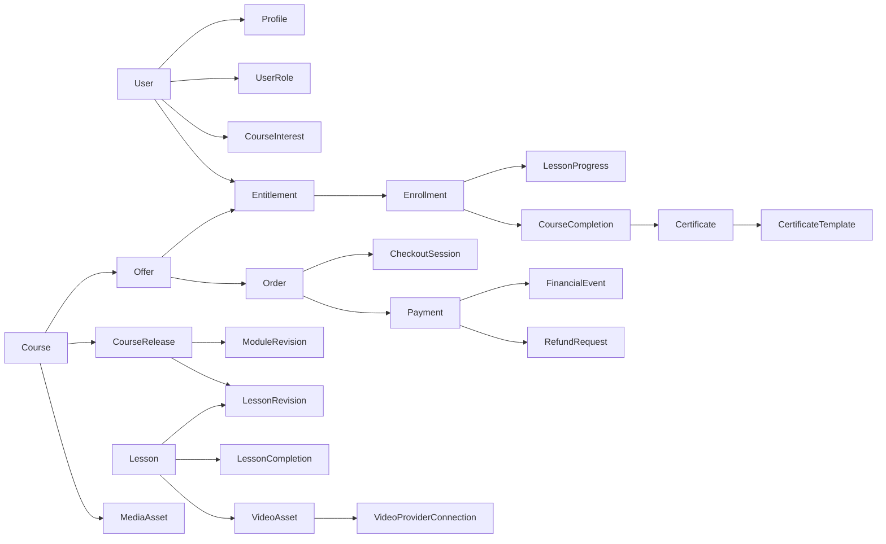

# 03 — Modelo de domínio e dados: entidades, invariantes e transações

**Regra:** os nomes aqui são contratos conceituais. A definição de PK, FK, índices, enum, check, isolamento e SQL final deve ser feita por tarefa de modelagem, revisada com testes PostgreSQL 18. Não converter este texto em migrations por cópia automática.

## 1. Diagrama do núcleo

Esse diagrama ilustra associações, **não** multiplicidades ou FKs definitivas. `CourseRelease` referencia revisões selecionadas da identidade estável de Module/Lesson; representações de ordenação devem ser versionadas. `Enrollment` é projeção de Entitlements válidos, não nova fonte autônoma de direito.

## 2. Identidade e autorização

**User (Better Auth)**: mínimo contratual da biblioteca. **UserProfile 1:1**: `displayName`, `certificateName`, avatar por MediaAsset e metadados do perfil. `UserPreferences` com tema (`system` default), `autoAdvanceLessons=false`, etc. Roles em `user_roles`, não um enum exclusivo no User. Grants tipados/normalizados, role Admin privilegiada com invariável transacional **≥1 Admin ativo**. `StaffInvitation`: convite one-time, expira, é revogável/reenvível e pode elevar um Student existente. Suspensão reversível auditada, sem impersonation.

**Invariantes:** e-mail verified/trusted para linking automático Google+senha; reset revoke sessions; 7d rolling PG sem cookie cache. Comandos de Staff exigem capacidade + ownership/target + estado + recent reauth quando sensíveis. Não retornar credenciais ou campos SQL completos à UI. Alterações de nome que impactem certificados históricos **não mutam snapshots**.

## 3. Cursos, catálogo e interesse

- `Course`: identidade pedagógica e configurações de progressão, carga horária, política de conclusão/versão corrente, template certificado.
- `Offer`: oferta comercial de exatamente um Course, modalidade `free | paid`, BRL integer cents, condições de acesso e meios de pagamento (snapshot no Order). Uma Course admite múltiplas Offers.
- `CourseInterest`: `(courseId,userId)` autenticado, estados `active|withdrawn|converted`, só quando não há Offer adquirível e o aluno ainda não tem direito efetivo. `CourseAvailabilityCycle` marca cada abertura relevante; envio por `(interestId, cycleId)` único. Não criar novo ciclo quando acrescentar Offer a Course já adquirível.
- `CourseRelease`: release curricular imutável publicada; representa ordenação e refs a revisões. `Module` e `Lesson` estáveis. `ModuleRevision` e `LessonRevision` imutáveis quando publicadas. Nova identidade de Lesson para mudança pedagógica material. `curriculum_key` proibido.
- `Lesson`: ContentLesson/QuizLesson; ContentLesson usa blocos tipados (Tiptap JSON rich-text restrito) e VideoAssets/Resources. QuizLesson tem configurações submit/pass, score e attempts.

**Invariantes:** status de visibilidade e disponibilidade não se confunde com direito adquirido; arquivar Course não elimina conclusão; conteúdo publicado só por transação que valida revisões e referências; releases retiradas mantêm prova histórica mas não fazem pin eterno de MediaAsset sem razão legal.

## 4. Entitlement, Enrollment e aprendizagem

- `Entitlement`: fonte de direito com `source=purchase|free_offer|admin_grant`, janela, suspensão/revogação e proveniência financeira/administrativa.
- `Enrollment`: projeção atual consolidada por User/Course. Derivação respeita direitos válidos e `expiresAt` real, não rotinas temporais como autoridade.
- `EnrollmentEpisode` ou contrato equivalente: âncora do drip relativo do episódio contínuo de acesso; continuação/recompra contínua preserva âncora; interrupção total seguida de nova concessão cria episódio novo.
- `LessonProgress`: primeiro/último aberto, dados operacionais mínimos para UX; não equivale a conclusão.
- `VideoProgress`: watch/position por VideoAsset, retomada somente se capability disponível; lifecycle menos durável que histórico de conclusão.
- `LessonCompletion`: evidência mínima (`lessonId,userId,method,completedAt,release/context`), protegida contra duplicidade. Conteúdo obrigatória apenas computa elegibilidade.
- `QuizAttempt`: submissão online; versão das questões, respostas, pontuação/resultado, tentativas, feedback conforme configuração. Tentativas default ilimitadas.
- `LessonDiscussion`: mensagens pedagógicas assíncronas com moderação Staff, identificador Lesson estável, sem chat realtime.
- `CourseCompletion`: evidência histórica primeira conclusão elegível; nunca apagada por release curricular posterior ou revogação de acesso.

**Invariantes de vídeo:** Course threshold default 90%; buscar ao limiar pode concluir; não implementar fronteira linear/anti-seek; autoavanço é ação distinta, apenas `ended` confiável e opt-in; `ended` não garante direito de acessar próxima aula se drip/sequência negar. Sem vídeo offline.

## 5. Commerce e financeiro

- `Order`: identificação da aquisição paga com snapshot imutável de Offer, preço, moeda, duração, meios, parcelamento e beneficiário. `CheckoutSession` e `Payment` são agregados distintos, permitindo multiplicidades por Order; TTL 60min para Order/checkout abertos conforme contrato.
- `WebhookInbox`: evento externo autenticado e deduplicado persistido antes do ACK, com raw payload temporário (30d) e normalização confiável.
- `FinancialEvent`: fatos append-only com proveniência; `Payment` é estado de evidência local autoritativa.
- `FinancialReview`: conflito de valor/identidade/estado, correlação incerta ou provider desconhecido; bloqueia concessão insegura.
- `RefundRequest`: comando assíncrono durável, integral na v1; no estado pendente suspende acesso conforme regra; falha inequívoca pode restaurar, confirmação final revoga. Não usar refund parcial automático.

**Invariantes:** checkout não prova pagamento; nunca usar preço do cliente; Pix `PAYMENT_RECEIVED`, cartão `PAYMENT_CONFIRMED` conforme estados seguros aprovados; dispute suspende e chargeback perdido revoga; ganho de dispute restaura quando devido; reembolso não apaga CourseCompletion/Certificate histórico; cada evidência financeira só aplica efeitos uma vez. DDL deve impor uniqueness onde decisivo, tests concorrentes.

## 6. Certificados

- `CertificateTemplate`: identidade reaproveitável entre Courses, versão editorial draft/published, fundo A4, campos pré-definidos manipuláveis; layout publicado é capturado **no snapshot de emissão**. Evitar histórico ilimitado de templates como domínio paralelo.
- `Certificate`: estado pending/generating/ready/failed e, se aplicável, revoked/superseded; código aleatório opaco, snapshot visual+semântico imutável, chave PDF R2 privada, `sha256` final, motivo de revogação auditado fora da projeção pública.
- `CertificateIssuerProfile`: nome/CNPJ emitente e informações necessárias; assinatura MediaAsset privada.
- `CertificatePurgeState`: metadados de prazo de exclusão, falhas/retries; tombstone mínimo permanece após purge.

**Invariantes:** apenas primeira conclusão cria emissão automática elegível (se Course policy automatic); snapshot e certificado não são alterados após emissão; reemitir revoga/substitui anterior com novo código; PDF revogado permanece privado por 90 dias após `revokedAt` (prazo de produto pendente de parecer jurídico), sem PNG armazenada; verificação pública minimizada, sem CPF/e-mail/pagamentos/razão interna.

## 7. Mídia, vídeo e integrações

- `MediaAsset`: objeto imutável por versão de arquivo; `purpose`, `visibility`, `state`, chave R2, tipo e dimensões reais, hash, refs e cleanup; master é imagem **já editada no browser**. Derivados públicos são cache/objetos controlados, não outra origem operacional.
- `VideoAsset`: provider, conexão associada, externalId, estado de upload/processamento, capabilities e controle de ownership; `VideoProviderConnection`: múltiplas conexões por provider, segredos AES-GCM versionados, master key Worker Secret por env, rotação auditada.
- `OutboxMessage`: fato de intenção durável, payload mínimo, dedupeKey, status, attempts, lease/fencing, expectedVersion. `IntegrationInbox` para respostas/webhooks autenticados. `AuditLog` durável separado de evlog/Sentry.
- `EmailRecipientState`: bounce/complaint/suppression. `MarketingPreference`: opt-in first-party separado do interesse em curso; unsub do Resend não pode ser sobrescrito por sync.

## 8. Concurrency map — casos a provar em PostgreSQL real

| Agregado/transição | Falha a impedir | Proteção preferida |
|---|---|---|
| Signup/linking | Duas identidades para mesmo e-mail confiável | Constraints + fluxo Better Auth verificado |
| Bootstrap Staff | Remover último Admin | Lock/constraint transacional e comando tipado |
| Curso gratuito | Duas concessões indevidas | Key de idempotência, ON CONFLICT, locks necessários |
| Checkout/Order | Reaproveitar snapshot expirado | Identidade de pedido, TTL, snapshot imutável |
| Payment → grant | Webhook duplicado ou fora de ordem | Unique external IDs, estado/predicado, FinancialEvent |
| Refund | Refund duplicado ou accepted desconhecido | Intent e idempotency provider, reconciler, fencing |
| CourseCompletion | Duas conclusões finais simultâneas | Unique(user,course) e lock funcional |
| Certificate | Duas emissões automáticas e PDFs divergentes | Intenção única + estado e checksum |
| Outbox | Dois consumers com mesmo claim | Lease/fencing, status predicates |
| MediaAsset | Publicar referência a objeto apagado | Sessão confirmada + ref tracking + cleanup seguro |
| CourseInterest | Duas mensagens no mesmo ciclo | Unique(interest,availabilityCycle) |

Sem duplicar tabelas/ledgers sem motivo. A implementação deve explicitar índices únicos/parciais, chaves estrangeiras, cascade/restrict e índices de consultas hot path por tarefa antes de migrations.
