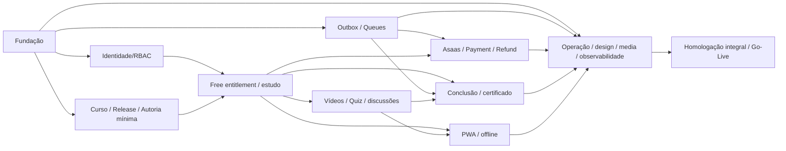

# 06 — Plano mestre de implementação incremental

## 1. Objetivo e filosofia

Construir uma nova plataforma pronta para centenas de alunos, mantendo domínio correto, infraestrutura econômica, processos seguros e UX da NeuroCapacitar. Não migrar código nem banco do legado sem revisão; não ativar produção antes do conjunto **integral** aprovado da v1. **Fundação mínima, depois jornadas verticais; tarefas pequenas, PRs coesos, testes de concorrência e segurança nos lugares de maior impacto.**

## 2. Mapa de dependências

A construção pode avançar intercalada: M4 deve ser preparado antes de qualquer e-mail transacional crítico; observabilidade, segurança, UI e docs começam em M0 e evoluem continuamente. A figura não significa que M6 só possa começar após concluir cada UI de M5.

## 3. Marcos e gates

| Marco | Entrega de valor | Dependências primárias | Gate de aceite |
|---|---|---|---|
| **M0** Fundação executável | React SPA+Hono mesmo Worker, Dev/Staging, TS7, DB e CI | Nenhuma | Vite build, worker smoke, Drizzle PG18 e tests no Staging |
| **M1** Identidade e Staff mínimo | Better Auth, sessões, RBAC/grants, UserProfile e bootstrap | M0 | Login Google/senha + logout, linking, suspensão, last Admin tests |
| **M2** Modelo curricular e autoria | Course, Offer, CourseRelease, Module/Lesson revisions, publisher | M0, M1 mínimo | Curso demonstrativo publicado de maneira atômica, histórico não alterado |
| **M3** Primeira jornada gratuita | Entitlement, Enrollment, drip, acesso, progress/completion | M1, M2 | Student entra, inscreve-se sem Asaas, abre e conclui aulas |
| **M4** Base assíncrona | Outbox/inbox, 5 Queues+DLQs, Cron reconciliação, evlog | M0, M1 | Mensagens toleram duplicata, publish crash, retry, lease e DLQ |
| **M5** Aprendizagem completa | Six video adapters, Quiz, discussões, CourseInterest, recursos | M2, M3, M4 parte | Provider capability tests, 90%/ended, quiz, discussão, avisos de abertura |
| **M6** Comércio e financeiro | Asaas Hosted, Order/Payment, RefundRequest, FinancialReview | M1, M2, M3, M4 | Sandbox e testes reais PG concorrentes, nunca compra indevida |
| **M7** Certificados | Template editor, Browser Run/PDF, issuance/revoke/reissue, public verify | M3, M4, M5, media | PDF imutável hash/R2, reemissão, purge, nenhum vazamento público |
| **M8** PWA | Install, offline selective, cache per-user, sync, safe update | M3, M5, M7 | Chrome + WebKit, iOS real quando pertinente, logout/cross-account e lease |
| **M9** Operação/UX integral | Staff, analytics, e-mail marketing, alertas, backup, polishing | Todos módulos em consolidação | Runbooks, métricas, a11y, restore drill, teste load |
| **M10** Lançamento | Release candidate, preflight, DNS/cutover, estabilidade | M0–M9 integral | Go/No-Go assinado, funcionamento real e rastreabilidade |

**Não há datas inventadas.** Antes de estimar prazo, medir velocidade real em M0–M2, dependências dos seis providers e quantidade de testes. Um backlog longo não substitui revisão de esforço baseada em evidência.

## 4. Sequência detalhada por faixa

### 4.1 Fundação e arquitetura

1. Iniciar repo novo, governance GitHub Free, lockfile, no secrets. Configurar scripts `dev`, `check`, `verify:quick`, `verify`, `docs:check`.
2. Vite React Compiler/TanStack Router+Query, Hono no Worker; `src/server` apenas adapters HTTP/Queue/Cron; feature modules.
3. Config Wrangler environments, secrets locais seguros, `wrangler types --check`, build com CLOUDFLARE_ENV, deploy Staging.
4. Neon PG18 local/CI/Staging, Drizzle `pg`+Hyperdrive direto sem cache de query, migrations SQL versionadas e drift checks.
5. Configurar Vitest Node/Workers, PG18 integration, Playwright smoke, Oxlint/Oxfmt, Semgrep/Gitleaks/Socket, actions security, architectural boundaries.
6. Design tokens e componentes fundamentais, sistema de erro/logs safe, RUM mínimo, documentação canônica.

### 4.2 Domínio base e primeira jornada

1. Better Auth schemas, User/Profile, verified mail/Google linking/passkeys opcionais, sessions.
2. Roles/grants Staff, recent reauth para comandos críticos e bootstrap do primeiro Admin.
3. Course/Offer e published availability, CourseRelease/Module/Lesson stable revisions, autoria mínima.
4. Entitlement/Enrollment e regras de expiração/drip/sequence; aquisição gratuita em transação PostgreSQL, sem Asaas, Order ou Payment.
5. StudentShell/lesson workspace, LessonProgress/LessonCompletion/CourseCompletion, testes de acesso.

### 4.3 Async e integrações

1. Outbox post-commit, producer, consumer, fencing, idempotência, DLQs e reconciliation sweep.
2. Resend Hosted TemplateContract, webhook assinado, supressão, alertas, testes sandbox.
3. VideoProviderConnection encryption+rotation, VideoAsset capabilities, adapters, managed/ref assets e player.
4. R2 upload, validação, public CDN variants, private authorization, cleanup/backup.

### 4.4 Módulos integrais

1. Quiz attempts, completion policy, graded result, shuffling, UI.
2. Discussões pedagógicas assíncronas, moderação autorizada.
3. CourseInterest ciclo por Course e e-mail transacional por disponibilidade.
4. Asaas Order/CheckoutSession/Payment, inbox, matiz de eventos, entitlement, reviews/refund/reconcile.
5. Certificado CourseCompletion/Certificate, renderer, editor visual A4, PDF R2, hash, revogação e reemissão.
6. PWA offline 72h, cache, sync, safe boundary, teste safari e reconexão.
7. Analytics first-party, Staff Operations Center, marketing first-party opt-in/Resend Contacts.

### 4.5 Endurecimento e lançamento

1. Security matrix: XSS/CSRF/RBAC/SSRF, upload, financial race, preview privacy, PWA threats.
2. Performance: queries Hot path, Neon CU, Workers CPU, R2, Queue backlog, player events, browser rendering.
3. Real Staging smoke, reconciliação, provider rate limiting, broken webhooks, contingência.
4. Backup `pg_dump`+`age`+R2+off-cloud, periodic/drill, privacy deletion/restore reconcile.
5. Production manual release, secrets fora do Github CI comum, DNS/cutover legado, Go/No-Go e seven-day stabilization.

## 5. Regras de passagem entre marcos

- **Entrada:** DoR aprovada, testes e credenciais adequadas para ambiente escolhido; riscos externos explicitados.
- **Saída:** DoD comprovada, erro/adversarial test, docs atualizados, nenhuma decisão substituída reimplementada, regressões críticas ausentes.
- **Mudança de requisito:** problema + prova + alternativas + consequência + aprovação explícita em domínio/segurança/custo. Não adicionar biblioteca ou serviço pago só por conveniência.
- **Controle de code review:** GitHub Free privado não impede merge sem CI; o responsável segue PRs revisáveis e *release verification* independente do workflow, guardando provenance de SHA e artifacts.

## 6. Organização de entregas e PRs

**Uma tarefa = um comportamento testável**, com schema/handler/UI/testes quando coesos. Evitar PR 'implementar todo financeiro'. Usar prefixos descritivos (`feat/auth-*`, `feat/learning-*`, `fix/...`), branches feature→staging→main; CI roda nos PRs e Staging. A documentação muda no mesmo PR se houver alteração de contrato; não atualizar 5 documentos desnecessariamente. No final de cada marco executar end-to-end sobre Staging e registrar anomalias/resolução.

## 7. Prioridades irreversíveis

1. Segurança/autorização e garantias de dados antes de UX otimista.
2. Admissão financeira autoritativa e reconcile-first antes de permitir pagamentos reais.
3. Snapshots de CourseCompletion/Certificate/PDF imutáveis antes de começar a emitir.
4. Estado persistente das filas e restauração testável antes da publicação externa.
5. Recursos públicos/históricos legados preservados durante transição e **nunca** rollback cego para legado após novas operações.
