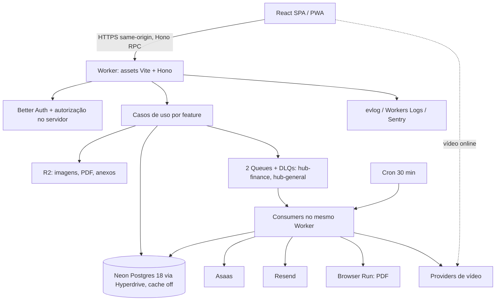

# Arquitetura — visão de uma página

**Estado:** especificação vigente (2026-10-10); código não implementado. Detalhes: [domínio](spec/domain.md), [contratos](spec/contracts.md), [segurança e operação](spec/security-operations.md), [ADRs](adr/README.md).

Monólito modular, um package, single-tenant, Cloudflare-first (não Cloudflare-only). Escala: ~20 alunos; a complexidade só existe onde protege dinheiro, acesso, privacidade ou durabilidade.

## Camadas

| Camada | Regra |
|---|---|
| `src/server` | Só adapters de entrada (HTTP, Queue, Cron) e composição. Sem regra de negócio |
| `src/features/*` | Regras de domínio e casos de uso. Não importam React, Hono, SQL nem SDK de provider |
| Adapters | Encapsulam Asaas, Resend, vídeo, R2, Browser Run; por capability, sem falsa uniformidade |
| UI | Não importa persistência nem segredos; controle visual nunca é autorização |
| Limites | dependency-cruiser fiscaliza imports; sem repository pattern universal |

## Princípios de execução

- O Postgres é a fonte da verdade (outbox/inbox, estado, auditoria); as filas aceleram e podem perder mensagens (a DLQ apaga em 4 dias).
- Efeito externo (Asaas, Resend, vídeo, R2) acontece **depois** do commit; resultado incerto vira reconciliação, não repetição às cegas.
- Expiração de acesso é avaliada por requisição, não por cron.
- Sem advisory locks (Hyperdrive): lease por linha com `FOR UPDATE SKIP LOCKED`.
- Sem cache de query do Hyperdrive para auth, acesso, financeiro e certificado.
- Segredos só em Worker Secrets por ambiente; nada de PII em logs.

## Ambientes

Development (local: workerd + PG18), Staging e Production isolados, cada um com seu Worker, projeto Neon (Free), buckets R2, filas e segredos. `CLOUDFLARE_ENV` é escolhido no build. Production é publicada manualmente. Ver [segurança e operação](spec/security-operations.md).

## Fora da v1

SSR/Next/TanStack Start, microsserviços, monorepo, D1/Durable Objects/KV, Workflows, boleto, NFS-e, cupons, bundles, assinatura, Web Push, CSV, IA tutora. Ver [decisões](decisions.md).
