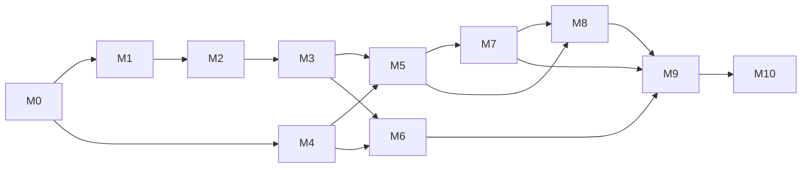

# Roadmap — M0 a M10

**Estado:** plano vigente (2026-10-10); nada iniciado. Tarefas em [tasks/](tasks/README.md). **Sem datas inventadas:** a velocidade real é medida em M0–M2 e só então se estima. Capacidade informada: ~4 h/dia, 1 dev + IA, sem prazo definido.

## Princípios

1. **Big-bang:** nenhuma Production da vNext antes da v1 integral e do Go/No-Go (ADR 0002). Marcos são de planejamento, não releases.
2. **Spikes primeiro:** incertezas técnicas viram spikes do M0 (1–2 dias cada), cada um com ADR curta "passou / reabrir decisão" (ADR 0024).
3. **Ordem de risco:** o núcleo (login, curso, matrícula gratuita, aula, conclusão) chega a Staging cedo, para homologar com a Staff real. Adapters além do primeiro, PWA offline e editor visual de certificado ficam no fim.
4. **Uma tarefa = um comportamento testável**, um PR coeso. Sem tarefa nova sem autorização.

## Marcos

| Marco | Entrega | Depende de | Gate de aceite |
|---|---|---|---|
| **M0** Fundação e spikes | Repo, Worker+SPA, Neon Free ×3, CI em duas camadas, base visual, planejamento do DNS, 9 spikes | — | Staging publicado; spikes com ADR |
| **M1** Identidade e Staff | Magic link, perfil, papéis e grants, convite, suspensão, CSRF e headers | M0 | Login, linking, último Admin, acesso cruzado pela API |
| **M2** Catálogo e autoria | Course/Offer, currículo vivo, publicação atômica, catálogo, página pública | M0, M1 | Publicação atômica; rascunho não vaza |
| **M3** Jornada gratuita | Entitlement/Enrollment, drip, matrícula gratuita e manual, conclusão | M1, M2 | Aluno entra, se inscreve e conclui; sem Asaas/Order |
| **M4** Assíncrono e e-mail | Outbox/inbox, 2 filas, cron, Resend, Operations Center inicial | M0, M1 | Duplicata, crash, lease e DLQ tolerados |
| **M5** Aprendizagem completa | Seis adapters, quiz, discussões, interesse, mídia R2, Ajuda | M2, M3, M4 | Testes de contrato por provider; 89%/90% |
| **M6** Comércio | Order, Checkout Asaas, webhook, reconciliação, reembolso | M1–M4 | Sandbox e corridas em PG real; nunca acesso indevido |
| **M7** Certificados | Emissão, editor visual, PDF, validação pública, revogação | M3–M5 | PDF imutável com SHA; paridade prévia↔PDF |
| **M8** PWA | Offline Student, lease, sync, update seguro | M3, M5, M7 | Chrome, WebKit e iPhone real |
| **M9** Operação e refinamento | Staff completo, marketing, hardening, backup, alertas, textos legais | M1–M8 | Restauração ensaiada; WCAG 2.2 AA; textos jurídicos |
| **M10** Migração e lançamento | ETL ensaiado, cutover, Go/No-Go, 7 dias de estabilização | M0–M9 | Go/No-Go assinado |

Observabilidade, segurança, UI e documentação evoluem desde o M0; o diagrama não impede trabalho intercalado (por exemplo, preparar o M4 antes de qualquer e-mail crítico).

## Regras de passagem

- **Entrada:** DoR cumprida, testes e credenciais adequados ao ambiente, riscos externos explícitos.
- **Saída:** DoD comprovada, teste adversarial, documentação atualizada, nenhuma decisão substituída reimplementada.
- **Mudança de requisito:** problema + evidência + alternativas + consequência + aprovação explícita (domínio, segurança, custo). Nada de serviço pago por conveniência.
- **Prioridades irreversíveis:** (1) segurança e garantias de dados antes de UX otimista; (2) admissão financeira autoritativa e reconciliação antes de pagamentos reais; (3) snapshots imutáveis de conclusão e certificado antes de emitir; (4) filas persistentes e restauração testável antes de abrir ao público.

## Pendências externas (não bloqueiam o plano)

Contador (NFS-e) · advogado do cliente (termos, retenções, transferência internacional) · cliente (provedores de vídeo e contas de teste, manual de marca e logo positivo, destino da cópia off-cloud) · responsável (varredura de segredos do repositório legado público). Ver [relatório final](review/relatorio-final.md#7-pendências-que-dependem-de-terceiros).
