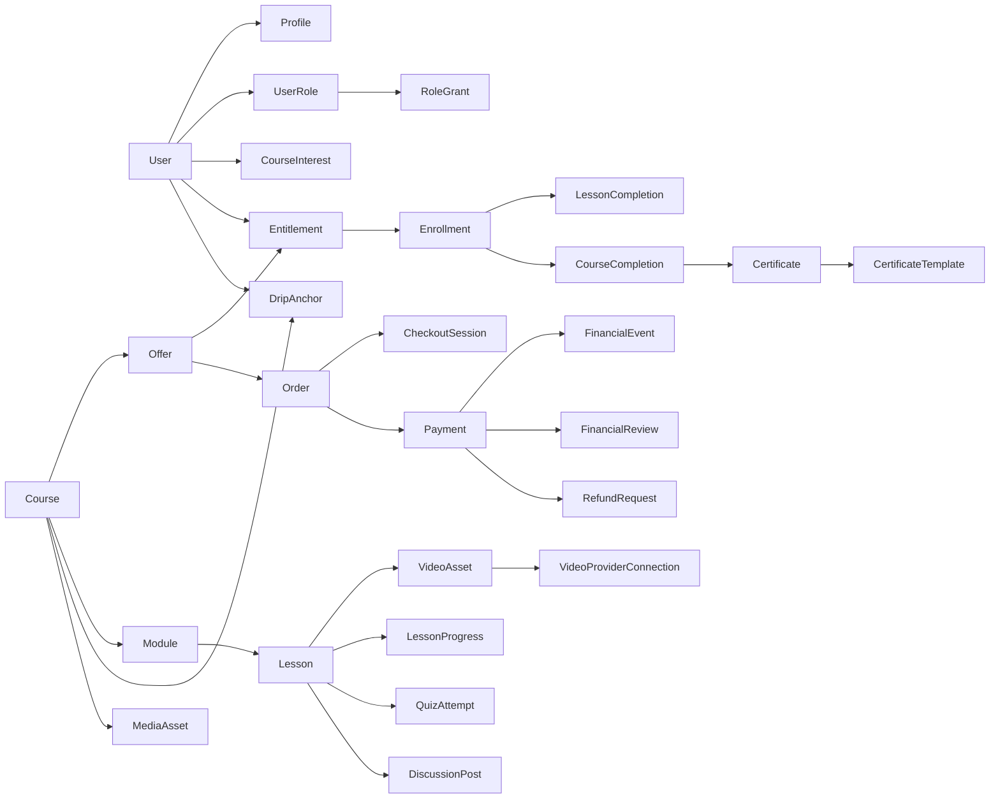

# Domínio e dados — Hub vNext

**Estado:** especificação vigente (2026-10-10); código não implementado.

Os nomes são contratos **conceituais**. PK, FK, índices, enums, checks, isolamento e SQL ficam para tarefas de modelagem, revisadas com testes em PostgreSQL 18 real. Este documento não contém DDL e não deve virar migration por cópia. Decisões: [registro do debate](../review/registro-do-debate.md) (Q-nn citados). Itens sem resposta estão em "Lacunas" (seção 11) e marcados `PENDENTE`.

## 1. Núcleo

O diagrama mostra associações, não multiplicidades nem FKs definitivas. `Entitlement` é a fonte do direito; `Enrollment` é projeção. Não existem `CourseRelease`, `ModuleRevision`, `LessonRevision`, `EnrollmentEpisode`, `curriculum_key` nem clones de publicação (Q32, Q33).

## 2. Identidade e autorização

- **User** (Better Auth, mínimo da biblioteca) + **Profile** 1:1 (`displayName`, `certificateName`, `certificateNameConfirmedAt`, avatar por MediaAsset) + **Preferences** (tema `system`, `autoAdvanceLessons=false`). Aceite versionado de Termos/Privacidade (`TermsAcceptance`: user, versão do documento, data) no cadastro (Q38).
- **Autenticação:** magic link é o método base de todos; a Staff entra **somente** por magic link (sem senha, Google, TOTP ou passkey); aluno pode adicionar Google e senha (Q52, Q61). Linking Google só com e-mail verificado; reset de senha revoga sessões; sessão PG rolling de 7 dias, sem cookie cache.
- **Invariantes do link:** uso único (consumo atômico), expiração curta, página de confirmação antes de criar a sessão (anti-scanner), limite por e-mail+IP, Turnstile no pedido. Valores (TTL, limites, armazenamento do contador) `PENDENTE (spike M0-10)`.
- Quem possui papel Staff **não** autentica por senha/Google: o servidor recusa essas credenciais; ao ganhar papel Staff, credenciais de aluno ficam inativas. Mecanismo `PENDENTE (spike M0-10)`.
- **Papéis:** `student` (implícito para todo User), `support`, `admin`, em `user_roles` (não exclusivos). Capacidades do Suporte por **grants** normalizados e tipados, concedidos pelo Admin. Admin possui todas as capacidades.
- **StaffInvitation:** convite de uso único, expira, revogável/reenviável; pode elevar um Student existente. Convida e gere grants apenas o Admin.
- **≥1 Admin ativo**, invariante transacional (remoção, rebaixamento e suspensão do último Admin são recusadas).
- Sem impersonation e sem edição genérica de User. Suspensão de conta é reversível e auditada. Ações sensíveis exigem reautenticação recente (novo link).
- **Prévia de aluno** (Staff): lê o currículo como o aluno vê; o servidor **recusa** gravação de LessonProgress, VideoProgress, QuizAttempt, LessonCompletion, CourseCompletion e DiscussionPost nesse modo.
- Alterar `certificateName` ou `displayName` nunca muda snapshots históricos.

### Capacidades

Toda decisão é **deny-by-default**, avaliada no servidor por capacidade + recurso + estado. A UI não é autorização.

| Capacidade | Admin | Suporte com grant | Suporte sem grant | Student |
|---|---|---|---|---|
| Criar curso | sim | não (nunca delegável) | não | não |
| Oferta, preço, disponibilidade | sim | não (nunca delegável) | não | não |
| Template e emitente de certificado | sim | não | não | não |
| Revogar certificado | sim | não | não | não |
| Convidar Staff; gerir papéis e grants | sim | não | não | não |
| Credenciais de integração; manutenção | sim | não | não | não |
| Editar curso (detalhes, módulos, aulas, quizzes, recursos) e **publicar** | sim | `course.edit` | não | não |
| Matricular manualmente / suspender acesso | sim | `access.grant` | não | não |
| Editar matrícula de suporte | sim | `enrollment.support_edit` | não | não |
| Executar reembolso | sim | `refund.execute` | não | não |
| Revisão financeira | sim | `finance.review` | não | não |
| Ver pedidos e análise financeira | sim | `finance.view` | não | não |
| Reemitir certificado | sim | `certificate.reissue` | não | não |
| Moderar discussões | sim | `discussion.moderate` | não | não |
| Editar FAQ/Ajuda | sim | `help.edit` | não | não |
| Ver auditoria | sim | `audit.view` | não | não |
| Operar fila operacional | sim | `ops.queue` | não | não |
| Ver inscritos, cursos e fila; prévia de aluno; responder pedidos de suporte | sim | sim | sim | não |
| Consumir cursos com direito vigente; progresso, quiz, discussão e certificado próprios | sim (como aluno) | sim (como aluno) | sim (como aluno) | sim |

Os identificadores de grant são ilustrativos; o catálogo final é contrato da modelagem. Reembolso fora da garantia de 7 dias exige o Admin, mesmo com o grant (seção 7).

## 3. Catálogo

- **Course:** identidade pedagógica e comercial estável: `slug` único (base das URLs `/comprar/[slug]`), título, descrição, capa/banner (MediaAsset), carga horária, `sequenceMode` (`guided|free`), limiar de vídeo (default 90%), política de certificado, estado (`draft|published|archived`). Arquivar não apaga direitos, progresso, conclusão ou certificados.
- **Offer:** oferta de **exatamente um** Course; Course tem 1:N Offers. Campos: modalidade `free|paid`, preço em centavos BRL inteiros (pago), **prazo de acesso em meses (≥1; obrigatório também na gratuita; sem vitalício)**, parcelamento máximo (1–12, sem juros), status (`draft|active|paused|archived`). Meios de pagamento fixos: Pix e cartão (sem boleto). Alterar Offer nunca altera Orders existentes (snapshot).
- Um Course é **adquirível** quando está `published`, tem currículo publicado e ≥1 Offer ativa.
- **CourseInterest:** `(user, course)` de usuário autenticado, estados `active|withdrawn|converted`; só existe quando o Course não é adquirível e a pessoa não tem direito vigente. `CourseAvailabilityCycle`: novo ciclo a cada transição não-adquirível → adquirível; aviso único por `(interest, cycle)`. Acrescentar Offer a Course já adquirível não abre ciclo. Interesse vira `converted` ao obter Entitlement. Leads externos não criam User nem interesse.

## 4. Currículo vivo

- **Estrutura:** Course → Module (plano, sem submódulos) → Lesson. IDs de Module e Lesson são **estáveis para sempre**; todo progresso, conclusão, quiz e discussão referenciam esses IDs.
- **Rascunho vs publicado:** cada Course tem um currículo **publicado** (o que alunos veem) e um **rascunho** (o que a Staff edita). Edição só atinge o rascunho; o rascunho tem contador de versão para controle otimista (não é revisão histórica).
- **Publicação atômica:** uma transação valida o rascunho (referências, mídia confirmada, vídeo ativo, quiz coerente, ordem, drip) e o promove a publicado de uma vez; falha de validação não altera o publicado. Duas publicações simultâneas do mesmo Course são serializadas.
- **Sem histórico de publicações:** o publicado anterior não é retido. Mudanças valem para todos imediatamente, inclusive D+N e obrigatoriedade.
- **Remoção:** Module/Lesson com progresso, conclusão ou discussão são **arquivados**, não apagados; arquivados somem do aluno e não contam para elegibilidade.
- **Lesson:** tipos `text` (conteúdo Tiptap JSON validado, renderizado por allowlist; botão Concluir), `video` (exatamente um VideoAsset, texto/recursos opcionais; conclui por limiar) e `quiz`. Campo `required` (obrigatória por padrão). Módulo tem `dripDays` (D+N, N ≥ 0).
- **Snapshot mínimo** (porque não há revisões): `CourseCompletion` guarda título do Course, carga horária, data e número de aulas obrigatórias concluídas; o Certificate guarda o snapshot da seção 8; `QuizAttempt` guarda as perguntas/alternativas apresentadas e a nota mínima vigente. Nenhum guarda a árvore curricular.
- Apagar Course com direitos, conclusões ou Orders é proibido (só arquivar).

## 5. Acesso e aprendizagem

- **Entitlement** (fonte): User, Course, `source` (`purchase|free_offer|admin_grant`), início, `expiresAt` (início + meses da Offer ou duração do grant), estado (`active|suspended|revoked`), proveniência (Order/Payment, Offer, ou autor + motivo). Imutável exceto transição de estado e extensão auditada.
- **Direito vigente** = estado `active` **e** `now < expiresAt`, avaliado **por requisição**; nenhum job de expiração é autoridade.
- **Oferta gratuita:** concessão transacional de Entitlement `free_offer` com chave de idempotência; **sem Order, Payment, CheckoutSession ou chamada Asaas**.
- **Matrícula manual** (`access.grant`): Entitlement `admin_grant` com duração e motivo obrigatórios, auditado; suspensão e revogação reversíveis/auditadas (reembolso revoga o Entitlement de compra).
- **Enrollment** (projeção por User+Course): estado e `expiresAt` efetivo derivados dos Entitlements, recalculados na mesma transação que muda um Entitlement; nunca fonte autônoma. Permanece (como expirado) após o fim do acesso para preservar o progresso.
- **DripAnchor** (único por `(User, Course)`): data do **primeiro** acesso efetivo; criada uma vez (insert idempotente, a primeira vence), **nunca reiniciada**, nunca recalculada. Recompra após expirar reutiliza a âncora e o progresso: módulos cujo D+N já passou ficam liberados de imediato. A âncora é fato durável próprio, não parte da projeção.
- **Acesso a uma aula** = direito vigente ∧ módulo liberado (âncora + D+N ≤ agora) ∧ (`free`, ou `guided` com as aulas **obrigatórias** anteriores concluídas). Aulas opcionais não bloqueiam nem contam.
- **LessonProgress:** por (User, Lesson), abertura/última abertura; não é conclusão.
- **VideoProgress:** por (User, Lesson), maior posição, duração informada pelo provider, última posição (retomada). Servidor limita a posição ao plausível, ignora eventos fora de ordem (monotônico) e aceita heartbeat 15–30 s e envios em pause/seek/ended/aba oculta. Seek livre; sem anti-seek.
- **LessonCompletion:** único por (User, Lesson); `method` = `video_threshold` (maior posição / duração ≥ limiar do Course, default 90%), `text_button` ou `quiz_pass`; idempotente. Não há botão de conclusão manual em vídeo nem conclusão manual pela Staff. Autoavanço só em `ended` confiável, opt-in (default OFF), cancelável, sem autoplay; `ended` não contorna drip/sequência.
- **QuizAttempt:** submissão **online**, corrigida no servidor; múltipla escolha única ou múltipla; nota mínima configurável; tentativas ilimitadas por padrão, máximo configurável; gabarito não chega ao cliente antes da submissão; aprovação gera LessonCompletion (`method = quiz`). Quiz obrigatório conta para conclusão e certificado. Implementado no M5-04: acerto total por questão (sem crédito parcial), cópia do quiz apresentado em cada `QuizAttempt` (append-only), sem novas tentativas depois de aprovado e sem como a Staff reabrir tentativas esgotadas (PENDENTE de confirmação do cliente).
- **Discussões:** por Lesson, assíncronas; `DiscussionPost` com um único nível de resposta; estados `visible|hidden|deleted`; `DiscussionReport` (denunciar). Moderação por `discussion.moderate`, auditada. Composer mostra aviso proibindo dados identificáveis de pacientes. Notificação por e-mail de resposta **adiada** (fora da v1). Sem tempo real.
- **CourseCompletion:** único por (User, Course); criado na mesma transação da última LessonCompletion obrigatória (elegibilidade contra o publicado vigente); **nunca apagado** por mudança curricular, expiração, revogação ou reembolso; gera a intenção de certificado via outbox.

## 6. Papel de cada projeção

`Entitlement` decide **se** há direito; `Enrollment` responde **quanto/até quando**; `DripAnchor` decide **desde quando** contam os dias; `LessonCompletion`/`CourseCompletion` guardam a **prova** de conclusão. Nenhum é derivado do outro de forma circular.

## 7. Comércio e financeiro

- Login obrigatório antes de comprar (sem guest checkout). Asaas Hosted Checkout (Pix e cartão até 12x).
- **Order:** aquisição paga com snapshot imutável (Offer, Course, preço em centavos BRL, meses, parcelamento máximo, meios) e beneficiário autenticado. TTL de 60 min para Order/checkout abertos (valor herdado do pacote antigo). Preço nunca vem do cliente.
- **CheckoutSession:** várias por Order; correlação com o retorno do Asaas **pela sessão de checkout** (`externalReference` vem nulo).
- **Payment:** estado local autoritativo de um pagamento; guarda dados exibidos à Staff (nome, CPF/CNPJ informado, valor, data, forma de pagamento). NFS-e fora da v1.
- **WebhookInbox** (`IntegrationInbox`): evento autenticado (token `asaas-access-token`), deduplicado e **persistido antes do ACK**; resposta HTTP 200 sempre; raw payload retido 30 dias.
- **FinancialEvent:** fatos append-only com proveniência (webhook, reconciliação, API, ação administrativa); cada evidência aplica efeitos uma única vez.
- **FinancialReview:** valor/identidade/estado divergente, correlação incerta, status desconhecido ou resultado ambíguo; bloqueia concessão insegura; resolvida por `finance.review`.
- **RefundRequest:** comando durável, integral (sem parcial); no estado pendente suspende o acesso, falha inequívoca restaura, confirmação revoga o Entitlement; chamada ao provider **nunca** dentro de transação PG (outbox + lease).

**Invariantes:**
- `CHECKOUT_PAID` e o retorno do checkout **nunca** concedem acesso.
- Pix libera em `PAYMENT_RECEIVED`, cartão em `PAYMENT_CONFIRMED`, sempre após reler o Payment na API e conferir valor, Order e beneficiário contra o snapshot.
- Resultado ambíguo → reconciliação/FinancialReview, nunca concessão.
- Disputa suspende; chargeback perdido revoga; disputa ganha restaura (mantido do pacote anterior).
- Reembolso: 7 dias garantidos desde a compra para quem tem `refund.execute`; depois, só exceção do Admin. Revoga acesso; CourseCompletion e Certificate emitido **permanecem**, com registro do reembolso na trilha financeira/auditoria (não na página pública).
- **Venda do legado:** histórico importado somente leitura; sem RefundRequest; reembolso manual no painel Asaas e revogação manual do Entitlement por `access.grant`.
- Desistência, exclusão, exportação de dados e troca de e-mail: sem funcionalidade; pedido por e-mail ao suporte e procedimento manual documentado (Q21).

## 8. Certificados

- **CertificateTemplate** (Admin): rascunho/publicado, fundo A4, campos pré-definidos; o layout publicado é copiado **no snapshot da emissão**. **CertificateIssuerProfile** (Admin): emitente, CNPJ, assinatura (MediaAsset privada).
- **Certificate:** estados `pending|generating|ready|failed|revoked|superseded`; **código opaco** aleatório; snapshot imutável (nome confirmado, título, carga horária, datas, emitente, layout, texto); PDF A4 gerado de HTML/CSS controlado via Browser Run, guardado em R2 **privado** com SHA-256 final.
- Emissão **assíncrona** (outbox) a partir do CourseCompletion; no máximo uma emissão automática por CourseCompletion. Nenhum PDF é gerado antes de `certificateNameConfirmedAt` existir (seção 11).
- **Reemissão** (`certificate.reissue`): novo código, substitui o anterior (`superseded`), auditada. **Revogação** (só Admin): motivo auditado fora da projeção pública.
- **Validação pública** por código opaco, mínima: sem CPF, e-mail ou pagamento; não oferece o PDF. Preview social via HTMLRewriter.
- **CertificatePurgeState:** PDF revogado fica privado 90 dias e depois é removido, mantendo tombstone mínimo — **CONDICIONAL a parecer jurídico**.
- ETL final preserva código, hash e URL de certificados do legado.

## 9. Mídia, vídeo, mensageria, auditoria e e-mail

- **MediaAsset:** objeto imutável por versão; `purpose`, `visibility`, `state` (`pending|confirmed|ready|deleted`), chave R2, tipo/dimensões reais, hash, referências. R2 canônico; **público só capas/banners**, o resto privado com entrega autorizada. Master editado no navegador; presigned PUT, confirmação e validação dos bytes; original da câmera não é guardado. Derivados (Images Free, 5.000 transformações únicas/mês) são cache com fallback estático.
- **VideoAsset:** provider (JMVStream, Panda, Cloudflare Stream, Mux, YouTube, Vimeo), conexão, `externalId`, estado, **capabilities** verificáveis (duração confiável, `ended`, progresso, restrição de domínio). Sem iframe arbitrário. Adapter só é **ativado na interface** após passar nos testes de contrato com conta real fornecida pelo cliente. YouTube é permitido em curso pago (risco aceito), com aviso na UI da Staff. Eventos do player: validar `event.origin` e `event.source`; duração vem do provider.
- **VideoProviderConnection:** várias por provider; segredos AES-GCM versionados, chave-mestra como Worker Secret por ambiente; rotação auditada; só Admin.
- **OutboxMessage** (fonte da verdade): categoria/fila (`finance` ou `general`), tipo, `dedupeKey` único, payload mínimo, estado (`pending|leased|done|failed|dead`), tentativas, `availableAt`, `leaseOwner`, `leaseUntil`, **token de fencing** crescente. **IntegrationInbox**: `(provider, eventId)` único, mesmo esquema de lease. A Queue apenas acelera (carrega o id da linha); o Cron de 30 min reenvia pendentes e leases vencidos; mensagem em DLQ (apagada em 4 dias) continua `failed/dead` no Postgres, visível na fila operacional. Entrega at-least-once, handlers idempotentes.
- **Claim por lease em linha:** `FOR UPDATE SKIP LOCKED` + incremento do token; toda escrita do consumidor é condicionada ao token vigente (consumidor atrasado perde). Chamadas externas usam chave de idempotência derivada do `dedupeKey`. **Sem advisory locks.**
- **AuditLog:** durável, append-only, separado de evlog/Sentry: ator, capacidade, alvo, antes/depois mínimos, motivo; sem segredos. Retenção `PENDENTE (advogado do cliente)`.
- **E-mail:** Resend Free (100/dia, 3.000/mês), Hosted Templates; outbox transacional; excedente adiado. Magic link e transacionais têm prioridade sobre marketing na fila de envio. `EmailRecipientState` (bounce, complaint, supressão). `MarketingPreference`: consentimento próprio, independente de interesse em curso; descadastro do Resend não é sobrescrito por sincronização. Cota de broadcasts `PENDENTE (verificar no Resend)`.

## 10. Mapa de concorrência

Provar em PostgreSQL 18 real; índices únicos/parciais, FKs, cascade/restrict e índices de hot path definidos por tarefa.

| Transição | Falha a impedir | Proteção |
|---|---|---|
| Cadastro/linking | Duas identidades para o mesmo e-mail | Unicidade de e-mail normalizado + linking só com e-mail verificado |
| Magic link | Uso duplo do link | Consumo atômico condicionado a "não usado"; expiração |
| Último Admin | Remover/rebaixar/suspender o último | Lock das linhas de Admin ativo na transação + contagem; comando tipado |
| Gratuito / matrícula manual | Concessão duplicada | Chave de idempotência; unicidade parcial de Entitlement vigente por origem |
| Âncora de drip | Duas âncoras ou reinício | Único `(User, Course)`; insert idempotente, primeira vence |
| Publicação de currículo | Publicações simultâneas ou sobre rascunho obsoleto | Lock da linha do Course + versão otimista do rascunho |
| Order/checkout | Reuso de snapshot expirado | Order imutável, TTL, nova sessão por tentativa |
| Webhook/Payment → acesso | Duplicado, fora de ordem, duas concessões | Inbox única por evento; unicidade do id externo do Payment; transição condicionada ao estado; efeito aplicado uma vez |
| Reembolso | Dois reembolsos ou resultado desconhecido | Um RefundRequest ativo por Payment (único parcial); idempotência no provider; lease; reconciliação |
| LessonCompletion | Duplicada ou concorrente | Único `(User, Lesson)`; escrita idempotente |
| CourseCompletion | Duas conclusões finais simultâneas | Único `(User, Course)` + lock da linha de Enrollment |
| VideoProgress | Evento antigo regride a posição | Atualização monotônica por sequência/maior posição |
| QuizAttempt | Estourar máximo de tentativas | Lock do par User+Lesson e único `(User, Lesson, nº)` |
| Certificate | Duas emissões/PDFs divergentes | Intenção única por CourseCompletion + predicado de estado + SHA-256 |
| Outbox/inbox | Dois consumidores com o mesmo claim | `SKIP LOCKED` + lease + fencing |
| MediaAsset | Referência a objeto inexistente/apagado | Confirmação de upload + rastreio de referências + limpeza segura |
| CourseInterest | Dois avisos no mesmo ciclo | Único `(interest, cycle)` |

## 11. Lacunas e modelagem pendente

- **Nomes físicos, PKs, FKs, enums, índices e DDL:** não definidos; modelagem por tarefa (M0/M1 em diante). Os nomes de grants acima são ilustrativos.
- **Página pública do certificado:** exibir o nome do titular? `PENDENTE (fechar na modelagem, Q37)`.
- **Nome do certificado:** em que momento a pessoa o confirma (cadastro, primeiro acesso, na conclusão antes da emissão)? Invariante já fixada: confirmação antes da 1ª emissão; troca posterior só vale para novas emissões/reemissões. `PENDENTE`.
- **Magic link:** TTL, limites, armazenamento do contador, janela de "reautenticação recente" e bloqueio de senha/Google para Staff — `PENDENTE (spike M0-10)`.
- **Webhook Asaas:** resposta quando a persistência na inbox falha (200 sempre vs. 5xx) e para token inválido — `PENDENTE (spike M0-14)`.
- **Empilhamento de acesso:** compra/concessão com Entitlement ainda vigente — somar a partir do fim vigente ou sobrepor? Recompra gratuita após expirar é nova concessão? `PENDENTE`.
- **Drip D+N:** dia civil (fuso do negócio) ou 24 h desde a âncora? `PENDENTE`.
- **"Editar matrícula de suporte":** alcance exato (ajustar prazo? motivo?) `PENDENTE`.
- **Suspensão de conta** (além de suspensão de acesso a curso): quem e por qual capacidade. `PENDENTE`.
- **Referência dos 7 dias de reembolso:** data do pedido ou da confirmação do pagamento — a fixar na política de reembolso (`PENDENTE (advogado do cliente)`).
- **Discussão após expirar o acesso:** leitura/escrita permitidas? Formato do texto (plano vs. restrito). `PENDENTE`.
- **Quiz de múltipla escolha:** pontuação tudo-ou-nada vs. parcial; novas tentativas após aprovação. `PENDENTE`.
- **Aula de vídeo com mais de um vídeo:** premissa atual é exatamente um VideoAsset. `PENDENTE`.
- **Slug:** política de troca e redirecionamento de slugs históricos. `PENDENTE`.
- **Janela de datas da Offer** (além do status). `PENDENTE`.
- **ETL (M10):** valor de `source` para acessos migrados (reutilizar `admin_grant` com marca de origem ou valor próprio); histórico financeiro do legado como registro somente leitura.
- **Retenções e privacidade** (PDF revogado, AuditLog, payload bruto, dados do pagador, exclusão/exportação por e-mail, troca de e-mail e quem a executa — hipótese: Admin em "manutenção", auditada): `PENDENTE (advogado do cliente)`.
- **NFS-e** fora da v1: `PENDENTE (contador)`.
- **Cota de broadcasts do Resend e orçamento de e-mails por dia:** `PENDENTE`.
